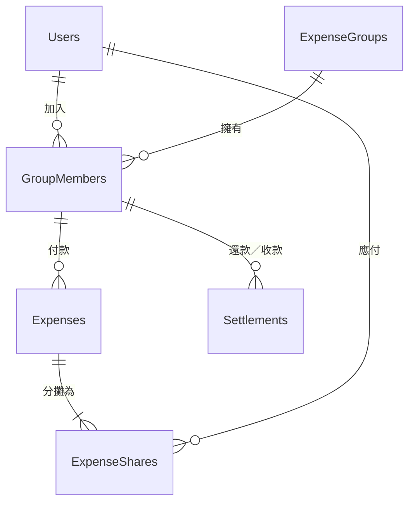

# 校園共同支出與分帳管理系統

## 組員與分工

| 姓名 | 學號 | 分工 |
|---|---|---|
| 李旻憲 | B11556150 | 競品分析、資料庫設計與 SQL 程式碼、GitHub 報告統整、現場 Demo |
| 吳浚右 | B11456028 | 需求分析、專題規劃 |
| 林恆慶 | B11456016 | SWOT 分析、簡報 |
| 曾柏勛 | B11456015 | 報告 |
| 李佳恩 | B11456047 | 報告 |
| 陳永昕 | B11456026 | 報告 |

## 問題與方法摘要

**問題**：宿舍室友、社團、班級常有共同支出（水電、網路、場地、班服），多半靠 LINE 記帳本或 Excel 記錄，月底結算容易算錯，也不容易查出誰欠誰多少。

**方法**：以 SQL Server 建立關聯式資料庫，將使用者、群組、支出、分攤明細、還款分開存放（正規化至 3NF），由資料庫即時計算每人淨欠款。

- 6 張資料表：`Users`、`ExpenseGroups`、`GroupMembers`（使用者與群組的 M:N 關聯表）、`Expenses`、`ExpenseShares`、`Settlements`
- 完整性約束：付款人與還款雙方必須是該群組成員（複合外鍵）；金額以 `CHECK` 限制大於 0
- 交易控制：`sp_AddExpenseEqualSplit` 將支出與分攤明細放在同一交易寫入，任一步失敗即整筆 `ROLLBACK`
- 即時查詢：`vw_MemberBalance` 計算每人淨餘額；`sp_MonthlyReport` 產生群組月結報表

淨餘額 = 代墊金額 − 應分攤金額 + 已還出金額 − 已收回金額（正數：別人欠我；負數：我欠別人）

## 環境說明

| 項目 | 版本／說明 |
|---|---|
| 資料庫 | Microsoft SQL Server 2019 |
| 管理工具 | SQL Server Management Studio (SSMS) |
| 作業系統 | Windows 10／11 |
| 其他套件 | 無 |

## 資料取得方式

本專題不使用外部或受版權限制的資料。`sql/04_seed_data.sql` 內為自行建立的**虛構測試資料**（6 位學生、3 個群組、11 筆支出、2 筆還款），執行即可產生，無需另外下載。

## 執行步驟

1. 安裝 SQL Server 2019 與 SSMS，以 SSMS 連線到本機 SQL Server。
2. 依序開啟並執行（F5）`sql/` 內的檔案：

| 順序 | 檔案 | 內容 |
|---|---|---|
| 1 | `01_create_database.sql` | 建立 `CampusSplitDB` |
| 2 | `02_create_tables.sql` | 建立 6 張資料表與索引 |
| 3 | `03_views_procedures.sql` | 建立 View 與 Stored Procedure |
| 4 | `04_seed_data.sql` | 匯入虛構測試資料 |
| 5 | `05_demo_queries.sql` | Demo 查詢，一段一段反白執行 |

## 範例輸出

以下為執行 `01`～`04` 後，於 `05_demo_queries.sql` 取得的結果。

**每人淨餘額（宿舍群組，`vw_MemberBalance`）**

| 成員 | 代墊 | 應分攤 | 已還出 | 已收回 | 淨餘額 |
|---|---:|---:|---:|---:|---:|
| 陳大華 | 1950.00 | 1167.25 | 0 | 0 | 782.75 |
| 王小明 | 1800.00 | 1027.25 | 0 | 300.00 | 472.75 |
| 林怡君 | 359.00 | 1167.25 | 300.00 | 0 | -508.25 |
| 張志豪 | 420.00 | 1167.25 | 0 | 0 | -747.25 |

**帳目平衡驗證**：三個群組（實齋 305 室、吉他社、資管二A）的淨餘額總和皆為 `0.00`。

**交易控制驗證**：分攤名單混入非群組成員時，回傳錯誤 `50002 分攤成員中有人不屬於此群組`，執行前後 `Expenses` 筆數相同。

**約束驗證**：輸入金額 `-100` 時，被 `CK_Expenses_Amount` CHECK 約束拒絕。
