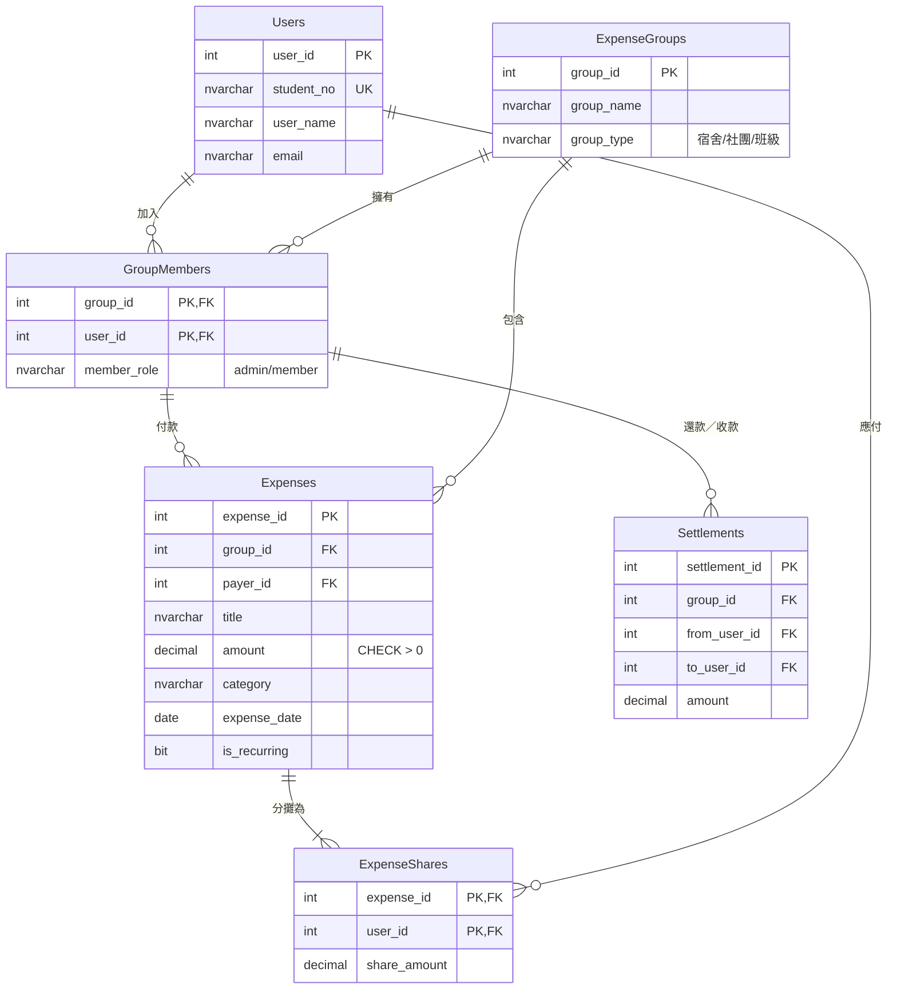

# 校園共同支出與分帳管理系統

> 國立屏東科技大學 資訊管理系｜資料庫管理系統 課程專題

宿舍室友、社團、班級常有共同支出（水電、網路、場地、班服），以往靠 LINE 記帳本或 Excel 記錄，月底結算容易算錯、找不到誰欠誰多少。本專題以 **SQL Server 關聯式資料庫** 建立分帳系統，讓群組成員隨時查詢每人的淨欠款與每月支出報表。

📺 DEMO 影片：https://youtu.be/（上傳後填入）

---

## 功能

| 功能 | 實作方式 | 階段 |
|---|---|---|
| 宿舍／社團／班級群組與成員管理 | `ExpenseGroups`、`GroupMembers`（M:N） | ✅ 期中 |
| 新增支出並自動平均分攤 | `sp_AddExpenseEqualSplit`（交易控制） | ✅ 期中 |
| 每人淨餘額（誰欠誰多少） | `vw_MemberBalance` | ✅ 期中 |
| 還款紀錄 | `sp_AddSettlement` | ✅ 期中 |
| 群組月結報表 | `sp_MonthlyReport` | ✅ 期中 |
| 最少轉帳次數結算 | Stored Procedure／CTE | 🔜 期末 |
| 修改稽核紀錄 | Trigger | 🔜 期末 |
| 週期性帳單（房租、網路費） | SQL Server Agent | 🔜 期末 |
| 網頁操作介面 | Python Flask | 🔜 期末 |

## 技術

- 資料庫：Microsoft SQL Server 2019
- 開發工具：SQL Server Management Studio (SSMS)
- 語言：T-SQL

## 資料庫設計（ERD）



### 設計重點

- **正規化到 3NF**：使用者、群組、支出、分攤各自獨立成表；「目前欠款」不另外存欄位，而是由 `vw_MemberBalance` 即時計算，避免資料不一致。
- **M:N 關聯**：一位學生可加入多個群組，一個群組有多位學生，透過 `GroupMembers` 關聯表處理。
- **完整性約束**：付款人與還款雙方必須是該群組成員（複合外鍵指向 `GroupMembers`）；金額以 `CHECK` 限制必須大於 0；還款不能自己付給自己。
- **交易控制**：新增支出時，`Expenses` 與 `ExpenseShares` 在同一個交易內寫入，任一步驟失敗就整筆 `ROLLBACK`。
- **分攤零頭處理**：除不盡的金額由第一位分攤者負擔，確保分攤總和一定等於支出金額。

### 淨餘額公式

```
淨餘額 = 代墊金額 − 應分攤金額 + 已還出金額 − 已收回金額
```

正數代表別人欠你，負數代表你欠別人；同一群組所有人的淨餘額加總必為 0。

## 如何執行

1. 開啟 SSMS，連線到本機 SQL Server。
2. 依序開啟並執行（F5）`sql/` 資料夾內的檔案：

| 順序 | 檔案 | 內容 |
|---|---|---|
| 1 | `01_create_database.sql` | 建立 `CampusSplitDB` 資料庫（會刪除同名舊庫） |
| 2 | `02_create_tables.sql` | 建立 6 張資料表與索引 |
| 3 | `03_views_procedures.sql` | 建立 View 與 Stored Procedure |
| 4 | `04_seed_data.sql` | 匯入測試資料（虛構） |
| 5 | `05_demo_queries.sql` | DEMO 查詢，建議一段一段反白執行 |

想重置資料時，重新從 1 執行到 4 即可。

## 檔案結構

```
.
├── README.md
├── docs/
│   └── DEMO_SCRIPT.md      # 影片錄製腳本
└── sql/
    ├── 01_create_database.sql
    ├── 02_create_tables.sql
    ├── 03_views_procedures.sql
    ├── 04_seed_data.sql
    └── 05_demo_queries.sql
```

## 團隊

| 姓名 | 分工 |
|---|---|
| 李旻憲 | 競品分析、GitHub 報告統整、DEMO、程式碼 |

## 參考資料

- Splitwise, Tricount, Settle Up, Spliit, SplitPro（競品分析，詳見專題規劃分析表附錄 A）
- Microsoft. *SQL Server technical documentation*. https://learn.microsoft.com/sql/sql-server/
